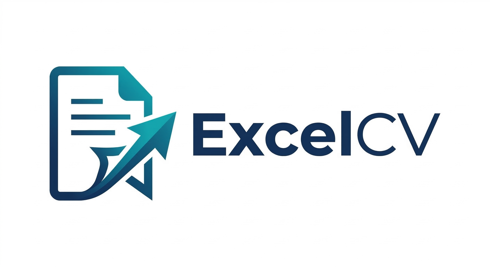

<p align="center">
  
</p>

<p align="center">
  <b>Scores a resume against a job description with explainable ATS metrics,<br>
  ranks multiple candidates side by side, and generates tailored cover letters.</b>
</p>

<p align="center">
  
  
  
  
</p>

---

ExcelCV is a career tool built on Streamlit and Google Gemini. Every score it reports
is explainable: the model returns structured JSON, which is merged with deterministic
scoring so a number can always be traced back to a reason. It also ranks a shortlist of
candidates against one job description, writes cover letters, and includes a resume
builder with live preview and PDF export.

## Features

### CV analyzer

- Upload a resume (PDF or DOCX, max 2 MB) and paste a job description
- **Explainable weighted score (0–100)** across five components: content quality, JD
  alignment, section structure, ATS essentials, contact completeness
- **JD skill matrix** — each required skill mapped to resume evidence (Found / Partial / Missing)
- **Rewrite assistant** — section-level Before → After → Why guidance for stronger bullets
- **Recruiter snapshot** — one-card hiring summary with key strength and key risk
- **Priority action plan** — ranked fix list with impact and effort guidance
- **Interview prep** — questions generated from the strengths and gaps found
- **Learning roadmap** — skill-gap closure plan with short practical targets
- **Portfolio checklist** — readiness check for sections, links and contact details
- Download the report as PDF or JSON; every analysis is saved to **My Analyses**

### Multi-resume comparison

- Compare 2–5 resumes against one job description
- Ranked table with inline meter bars: final score, JD alignment, ATS parse, sections, issues
- Eight sort options that renumber the rank column and carry through to CSV and PDF exports
- Top match card with an identity-based winner pill that tracks the true top match across sorts
- Per-resume drill-down with summary, suggestions, missing keywords, and a jump to the full report
- CSV and ReportLab PDF export of the shortlist
- Quota short-circuit: if one file hits a 429, the rest are marked `skipped (rate limit)`
  rather than burning more quota
- Saved per user; revisit from **My Comparisons**

### Cover letter generator

Upload a resume and job description, optionally add company, role, source and tone.
Gemini drafts the letter, which renders as Markdown and downloads as DOCX.

### Resume builder

- Three-panel workspace: sections and style controls, editable cards, zoomable preview
- Live preview that updates as you type, through a postMessage JS bridge
- Three templates — Classic, Creative, Modern — each with a distinct layout in both the
  preview and the exported PDF
- Nine section types, all collapsible, reorderable and individually hideable
- Accent colour, font, font size, line height and spacing, persisted per saved CV
- One-click PDF download; manage saved CVs from **My CVs**

### Evaluation toolkit

Add a human reviewer score per resume and track MAE, RMSE and correlation between the AI
and human scores. Benchmark JSON exports for measuring model quality over time.

### Accounts

Email and password registration with bcrypt, Google OAuth 2.0, and optional persistent
login via an HMAC-signed cookie. Password reset by email. Account settings for changing
email or password and deleting the account.

## Tech stack

| Layer | Technology |
|---|---|
| Frontend and server | Streamlit |
| AI | Google Gemini 2.0 Flash (`google-generativeai`) |
| Database | SQLite via SQLAlchemy ORM |
| Auth | bcrypt, HMAC-SHA256 signed cookies, Google OAuth 2.0 |
| Document parsing | pypdf, python-docx |
| PDF export | ReportLab (reports), headless Chromium via Playwright (resume builder) |
| DOCX export | python-docx |
| Email | SMTP, optional, for password reset |

## Getting started

**1. Install dependencies.**

```bash
pip install -r requirements.txt
```

**2. Install the Chromium browser used by the resume builder's PDF export.**

```bash
python -m playwright install chromium
```

The rest of the app works without this, but the resume builder's **Download PDF** button
will not.

**3. Create a `.env`.** Copy `.env.example` and fill in the two required values:

```env
GOOGLE_API_KEY=your-gemini-api-key
SESSION_SECRET=a-64-character-random-hex-string
```

`SESSION_SECRET` is **required** — the app refuses to start without one, and rejects
placeholder or short values. Generate one with:

```bash
python -c "import secrets; print(secrets.token_hex(32))"
```

Everything else is optional and documented inline in `.env.example`: auth throttling,
Gemini rate limits and input caps, Google OAuth credentials, and SMTP for password reset.

**4. Run it.**

```bash
streamlit run app.py
```

The SQLite database is created at `data/excelcv.db` on first run.

See [docs/SETUP.md](docs/SETUP.md) for the full walkthrough, including OAuth and SMTP.

## Testing

```bash
python -m unittest discover -s tests -p "test_*.py" -q
```

The tests cover auth and session handling, the session-secret guard, OAuth state binding
and verified-email checks, prompt fencing of untrusted resume text, scoring, the analysis
runner, the cover-letter pipeline, compare and upload helpers, SQLite settings, and
committed configuration.

CI runs ruff, mypy (Streamlit UI pages excluded), a pip-audit dependency audit that fails
on any advisory, a compile check and the full suite on every push and pull request.

## Project structure

```text
excelcv/
├── app.py                      # Entry point: routing, auth gating, theme
├── src/
│   ├── config.py               # Environment loading and file-size limits
│   ├── database.py             # SQLAlchemy models
│   ├── auth_utils.py           # Sessions, cookies, bcrypt, OAuth browser binding
│   ├── oauth_utils.py          # Google OAuth state and token exchange
│   ├── gemini_client.py        # Gemini calls: CV analysis
│   ├── prompt_fence.py         # Delimiter fencing for untrusted prompt input
│   ├── pdf_utils.py            # PDF and DOCX text extraction
│   ├── email_utils.py          # SMTP password-reset email
│   ├── cover_letter/           # Prompt, pipeline, validation, DOCX export
│   ├── services/               # Scoring, evaluation, report and PDF generation
│   ├── ui/                     # Streamlit pages, layout, theming, resume builder
│   └── assets/                 # Icons and the global CSS template
├── tests/                      # Unit tests
├── docs/                       # Setup, feature references, metrics documentation
├── scripts/                    # Project report generators
├── assets/images/              # Logos
├── data/                       # SQLite database, created at runtime, gitignored
└── .github/workflows/          # CI
```

## Database schema

```text
users
  id (UUID PK) | email | hashed_password | full_name | google_id | created_at

password_reset_tokens
  id (UUID PK) | user_id (FK) | token_hash | expires_at | created_at

cvs                 resume builder saves
  id (UUID PK) | user_id (FK) | title | template | data (JSON) | created_at | updated_at

analyses            saved on every single-resume upload
  id (UUID PK) | user_id (FK) | cv_name | job_description | result (JSON)
              | match_score | created_at

comparisons         saved on every successful multi-resume run
  id (UUID PK) | user_id (FK) | job_description | rows (JSON) | errors (JSON)
              | warnings (JSON) | resume_count | top_score | top_resume_name | created_at
```

## Troubleshooting

| Problem | Fix |
|---|---|
| App refuses to start, complaining about `SESSION_SECRET` | Generate one as shown above. Placeholder and short values are rejected on purpose. |
| Resume builder PDF download fails | Run `python -m playwright install chromium`. |
| `Missing GOOGLE_API_KEY` | Add it to `.env`. |
| DOCX contained no extractable text | The file holds image-based text. Open it in Word and check the text is selectable. |
| Google OAuth not working | `GOOGLE_CLIENT_ID`, `GOOGLE_CLIENT_SECRET` and `GOOGLE_REDIRECT_URI` must match the Google Cloud Console configuration exactly. |
| Google sign-in reports a missing cookie | Click Continue with Google again. If it repeats, the browser is blocking cookies for this site. |
| Gemini 429 during a comparison | Remaining files are marked `skipped (rate limit)`, so only the unfinished ones need retrying. |

## Reference documentation

- [docs/SETUP.md](docs/SETUP.md) — full setup walkthrough
- [docs/excelcv.md](docs/excelcv.md) — repository snapshot
- [docs/compareCV.md](docs/compareCV.md) — multi-resume comparison
- [docs/report_page.md](docs/report_page.md) — analysis report
- [docs/resume_builder.md](docs/resume_builder.md) — resume builder
- [docs/METRICS_DOCUMENTATION.md](docs/METRICS_DOCUMENTATION.md) — how each metric is calculated
